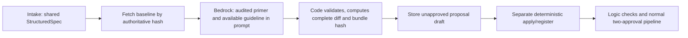

# Vera Change Planner Agent

The edit-path agent, updated for the shared packages on main at `a475d1c`. Intended for **the agents/change-planner branch**, without editing or merging into main.

## What it does



- Imports `StructuredSpec` and `LogicModel` from **@vera/schemas**; no private competing schema.
- Imports snapshot hashing/canonicalization from **@vera/workflow-data**, and versioned artifact refs from **@vera/artifact-storage/contracts**.
- Accepts `requestKind: plain_language_edit`, `editText`, `baselineSnapshotHash`, string `pathway` and `guideline` metadata directly from Intake.
- Supports the locked shared inputs, condition operators, actions and flag categories. Preserves options/decimal values and flags.
- Code owns new IDs, diffs, risk hints and hashes. Rule/input ordering is explicit in the diff. Unknown clinical fields are rejected instead of silently stripped.
- One happy-path model call; one primary-model repair, then one escalated final repair. No model-invoked tools, KB, vectors, Memory or Cross-Check.
- Complete input screened before every model call. Static prompt context gets a cache checkpoint; cache usage is measured, not guaranteed.
- Missing clinical citations/quotes become `uncited_rule` flags; ambiguous plans remain `needs_clarification` and unapproved.

The model emits a complete proposed shared LogicModel, rationale, flags, and `citationQuotes: [{ruleId,quote}]`. Quotes live outside the shared Citation schema; this avoids adding incompatible `quote` fields. Exact quote presence is checked, not clinical correctness or entailment. Downstream deterministic checks and human approvals remain mandatory.

## Install and verify (repository root)

First bring current main into your Change Planner branch as described in START_HERE.txt. This changes that branch only. Then overlay the ZIP's files.

```bash
npm ci
npm run check
npm run test:agents
npm run demo --workspace @vera/agent-change-planner
```

The root lockfile is authoritative. There is deliberately no agent-level lockfile. Root build compiles storage/workflow packages before the TypeScript agent projects; the root TypeScript references include this agent. The synthetic demo uses mocks, no AI/cloud calls or remote writes.

Verified locally: root clean install, workspace build/check, **97 combined agent/schema tests**, including **44 planner tests**. The suite includes actual shared Intake input, shared Drafting-format logic and the workflow package's real hash function. Storage/cloud/CHT end-to-end behavior is not claimed by those tests.

## Live worker (after team infrastructure is connected)

```bash
cp agents/change-planner-agent/.env.example agents/change-planner-agent/.env.local
# Configure the model, mandatory Guardrails, Gateway tools and identity token file.
node --env-file=agents/change-planner-agent/.env.local \
  agents/change-planner-agent/dist/server.js
```

`GET /healthz` checks process health; `POST /change-plan` takes the shared agent envelope from `@vera/schemas` (`{ changeId, runId, tenant, payload: { spec, revision? } }`, where `spec` is the edit StructuredSpec and `revision` is `{ gate, notes }` on a re-plan after a human rejection). It always answers 200 with an `AgentResult` (`ok: true` with the `ChangePlan`, or `ok: false` with a `failure`); see `src/handler.ts`. Only 401 (worker token), 429 (busy) and 413 (body over 64 KiB) are non-2xx. Non-loopback listeners require an injected worker Bearer token. The configured inference profiles must be available in your workshop account. No static AWS credentials or CHT credentials belong in the request or repository.

Gateway is a thin adapter exposing exactly a deterministic baseline read and unapproved proposal-draft write. No direct storage/KB fallback. Those shared services, Identity/Cedar/collector wiring, and the deterministic apply/register step must still be supplied by their owners. The token file reader is not an Identity broker.

```bash
# Build context MUST be the repository root.
docker build -f agents/change-planner-agent/Dockerfile -t vera-change-planner .
```

Docker build and live AWS deployment were not verified here. Pin the base image digest in your release configuration. Use private EC2 networking, authenticated ingress and least-privilege workload roles.

See [docs/INTEGRATION.md](docs/INTEGRATION.md) for tool contracts, context receipts, migration and the orchestrator handoff. Schemas/examples can be regenerated after a root build with `npm run contracts --workspace @vera/agent-change-planner`.
